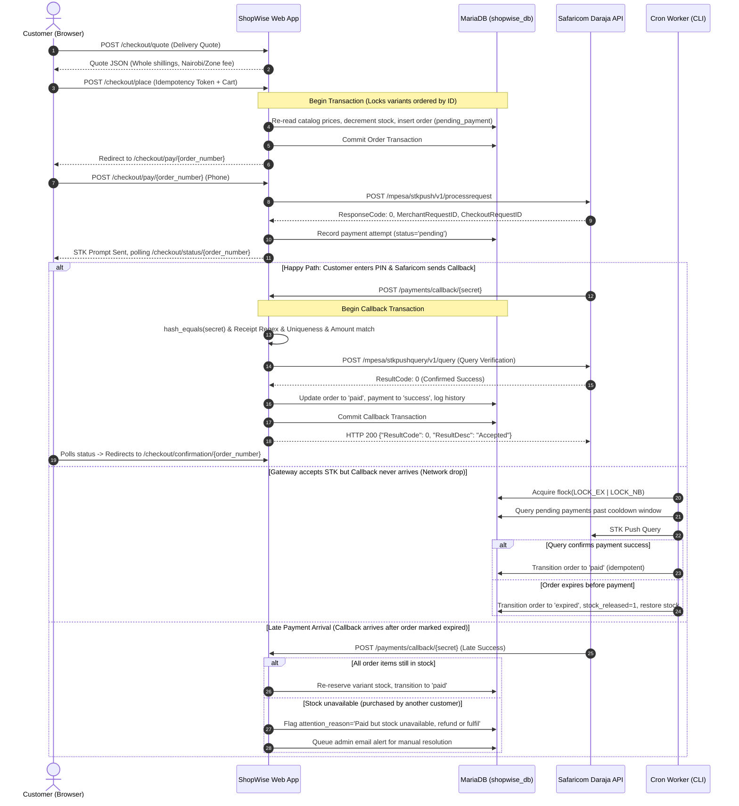

# ShopWise Kenya - Payment & Checkout Flow Architecture

This document provides a comprehensive, step-by-step technical explanation of the ShopWise Kenya checkout, order lifecycle, and M-Pesa (Safaricom Daraja STK Push) integration. It details system guarantees, database constraints, concurrency controls, edge-case reconciliation, and explicitly documents Daraja protocol assumptions.

---

## 1. High-Level Lifecycle Diagram

---

## 2. Step-by-Step Flow & Guarantees

### Phase A: Cart to Order Placement
1. **Catalog Re-Read & Price Snapshotting**
   - **File & Lines:** [`app/src/Services/OrderService.php`](file:///opt/lampp/htdocs/shopwise-platform/app/src/Services/OrderService.php#L720-L770)
   - **Mechanism:** The server never trusts client-submitted prices, discounts, subtotal, total, or product names. During order creation, each `variant_id` is re-read from `products` and `product_variants`. Line totals, subtotal, delivery fee, and discount are recomputed on the server.
   - **Whole-Shilling Guarantee:** All currency values are whole shillings. Fractional prices or fees are rejected. Percent discounts round down (`floor`) to the nearest shilling. Orders cannot be discounted below KES 1.

2. **Idempotency & Concurrent Order Placement**
   - **File & Lines:** [`app/src/Services/OrderService.php`](file:///opt/lampp/htdocs/shopwise-platform/app/src/Services/OrderService.php#L710-L735), [`app/src/Services/OrderService.php`](file:///opt/lampp/htdocs/shopwise-platform/app/src/Services/OrderService.php#L930-L945)
   - **Mechanism:** The client generates or receives an `idempotency_token` passed with `POST /checkout/place`. The `orders` table enforces a unique key constraint on `idempotency_token`. If 20 parallel requests submit the same token, MariaDB rejects duplicates (`SQLSTATE[23000]`), and the transaction returns the single existing order record without creating duplicates.

3. **No Double Stock Deduction (Deterministic Row-Locking & Atomicity)**
   - **File & Lines:** [`app/src/Services/OrderService.php`](file:///opt/lampp/htdocs/shopwise-platform/app/src/Services/OrderService.php#L735-L775)
   - **Mechanism:** When deducting inventory for an order, variant IDs are sorted ascending (`ORDER BY pv.id ASC`) and locked via `SELECT stock_qty FROM product_variants WHERE id = :id FOR UPDATE`.
   - **Deadlock Avoidance:** Consistent lock ordering across all checkout requests prevents database deadlocks.
   - **Atomicity:** Decrement occurs via `UPDATE product_variants SET stock_qty = stock_qty - :qty WHERE id = :id AND stock_qty >= :qty`. If stock is insufficient, the transaction rolls back, throwing a `DomainException`. Stock can never drop below zero.

4. **Coupon Reservation & Usage Limit Enforcement**
   - **File & Lines:** [`app/src/Services/CouponService.php`](file:///opt/lampp/htdocs/shopwise-platform/app/src/Services/CouponService.php#L440-L480)
   - **Mechanism:** Coupons are locked with `SELECT * FROM coupons WHERE id = :id FOR UPDATE`. If `used_count >= usage_limit`, redemption is refused. `used_count` increments atomically inside the order transaction.

---

### Phase B: STK Push Initiation & Retry Safeguards
1. **Sanitization and Field Length Truncation**
   - **File & Lines:** [`app/src/Services/MpesaService.php`](file:///opt/lampp/htdocs/shopwise-platform/app/src/Services/MpesaService.php#L430-L465)
   - **AccountReference Bound:** Truncated to at most 12 alphanumeric characters (`substr(cleanRef, -12)`).
   - **TransactionDesc Bound:** Truncated to at most 13 characters (`StorePurchase`).
   - *Status:* Assumed Daraja constraint based on Safaricom specification; marked UNKNOWN until verified in sandbox.

2. **No Double Charge & Retry Cooldown**
   - **File & Lines:** [`app/src/Services/MpesaService.php`](file:///opt/lampp/htdocs/shopwise-platform/app/src/Services/MpesaService.php#L690-L775)
   - **Mechanism:** `MpesaService::canRetryStkPush($order)` enforces:
     - Maximum 3 payment attempts per order.
     - Cooldown of at least 60 seconds since the last attempt.
     - Refusal if the previous attempt succeeded or is currently being verified.
     - An automatic STK Push Query to Daraja is executed *before* allowing another push, ensuring the user is not prompted again if they already authorized the payment.

---

### Phase C: Callback Processing & Verification
1. **Secret Verification (Timing-Attack Resistant)**
   - **File & Lines:** [`app/src/Services/MpesaService.php`](file:///opt/lampp/htdocs/shopwise-platform/app/src/Services/MpesaService.php#L780-L788)
   - **Mechanism:** Callback URL contains a high-entropy secret token (`/payments/callback/{secret}`). Comparison uses `hash_equals($expectedSecret, $providedSecret)`. Mismatch strictly returns HTTP 404 without leaking endpoints or internal error details.

2. **Keyword Filter on Callback URL**
   - **File & Lines:** [`app/src/Services/MpesaService.php`](file:///opt/lampp/htdocs/shopwise-platform/app/src/Services/MpesaService.php#L350-L355)
   - **Mechanism:** `MpesaService::getCallbackUrl()` checks that the full callback URL does not contain "mpesa", "safaricom", or "daraja", throwing an exception if detected.

3. **Receipt Uniqueness & Format Validation**
   - **File & Lines:** [`app/src/Services/MpesaService.php`](file:///opt/lampp/htdocs/shopwise-platform/app/src/Services/MpesaService.php#L930-L985)
   - **Format:** Evaluated against `^[A-Z0-9]{10}$`.
   - **Uniqueness:** Checked against `payments` table via `SELECT id FROM payments WHERE mpesa_receipt = :rcpt AND id <> :id`. If a duplicate is detected, the payment is rejected, `orders.attention_reason` is flagged, and an administrator alert email is queued.

4. **Amount Matching**
   - **File & Lines:** [`app/src/Services/MpesaService.php`](file:///opt/lampp/htdocs/shopwise-platform/app/src/Services/MpesaService.php#L988-L1015)
   - **Mechanism:** The `Amount` item from `CallbackMetadata` is compared to the expected `payments.amount` within a `0.01` tolerance. If the amount does not match, payment status is set to `failed`, `orders.attention_reason` is set to `'Callback amount mismatch: expected KES X, received KES Y'`, and an administrator attention alert is dispatched.

5. **STK Push Query Verification (`verify_callback_with_query`)**
   - **File & Lines:** [`app/src/Services/MpesaService.php`](file:///opt/lampp/htdocs/shopwise-platform/app/src/Services/MpesaService.php#L1017-L1043)
   - **Mechanism:** Before accepting a callback as paid, the service makes an independent server-to-server query to Safaricom's STK Query endpoint. If the query does not confirm success (e.g. gateway timeout or pending status), the payment is marked `pending_verification` to be reconciled by cron, preventing fraudulent spoofed callbacks.

6. **Order Transition to Paid (Payment Row Isolation)**
   - **File & Lines:** [`app/src/Services/OrderService.php`](file:///opt/lampp/htdocs/shopwise-platform/app/src/Services/OrderService.php#L1050-L1110)
   - **Mechanism:** `transitionToPaid($orderId, $mpesaReceipt, $rawCallback, $ip, $paymentId)` updates only the specific payment attempt ID (`WHERE id = :pid`), avoiding unique constraint collisions on `uq_payments_receipt` when orders have multiple retry records.

---

### Phase D: Order Expiry, Late Payments & Reconciliation
1. **Overdue Order Expiry (Cron Worker)**
   - **File & Lines:** [`cron/expire_orders.php`](file:///opt/lampp/htdocs/shopwise-platform/cron/expire_orders.php#L1-L60), [`app/src/Services/OrderService.php`](file:///opt/lampp/htdocs/shopwise-platform/app/src/Services/OrderService.php#L1215-L1285)
   - **Concurrency Guard:** Protected by `flock($fp, LOCK_EX | LOCK_NB)` to ensure only one instance of the expiry cron runs at a time.
   - **No Double Stock Restore:** Checked with `WHERE stock_released = 0`. Setting `stock_released = 1` guarantees stock is returned to `product_variants` exactly once, with an `inventory_movements` audit record (`reason='expiry_restore'`).
   - **Coupon Release:** Unpaid expired orders release their coupon redemption (`used_count` decremented, redemption deleted). Paid cancelled orders retain coupon redemptions.

2. **Late Payment Recovery (Success Callback After Expiry)**
   - **File & Lines:** [`app/src/Services/OrderService.php`](file:///opt/lampp/htdocs/shopwise-platform/app/src/Services/OrderService.php#L1115-L1210)
   - **Scenario:** Customer authorizes M-Pesa prompt after the 30-minute order window has expired and stock was returned.
   - **Resolution:**
     - Checks if all order variant items are still in stock.
     - *If available:* Re-reserves stock, creates `inventory_movements` records, resets `stock_released = 0`, transitions order to `paid`, and sends confirmation emails.
     - *If unavailable:* Sets `orders.attention_reason = 'Paid but stock unavailable, refund or fulfil'` and dispatches immediate notification to administrators for manual fulfillment or refund.

---

## 3. Daraja API Assumptions & Unknowns

In accordance with constitutional verification rules, all integration points that cannot be confirmed live against Safaricom's documentation servers in this environment are cataloged below:

| Field / Parameter | Documented Assumption in System | Status | Verification Plan |
| :--- | :--- | :--- | :--- |
| `AccountReference` | Maximum length is 12 characters. Truncated from right of order number. | **UNKNOWN** | Confirm in Daraja Sandbox STK Push test. |
| `TransactionDesc` | Maximum length is 13 characters. Set to constant `StorePurchase`. | **UNKNOWN** | Confirm in Daraja Sandbox STK Push test. |
| Callback URL Keywords | Safaricom rejects URLs containing "mpesa", "safaricom", "daraja". | **NEEDS CONFIRMATION** | Verified via renamed route `/payments/callback/{secret}`. |
| STK Query Endpoint | `https://sandbox.safaricom.co.ke/mpesa/stkpushquery/v1/query` | **UNKNOWN** | Test via `scripts/mpesa_sandbox_check.php`. |
| Result Codes | 0=Success, 1=Insufficient Balance, 1032=Cancelled by user, 1037=Timeout, 2001=Invalid PIN | **UNKNOWN** | Sandbox simulator response verification. |
